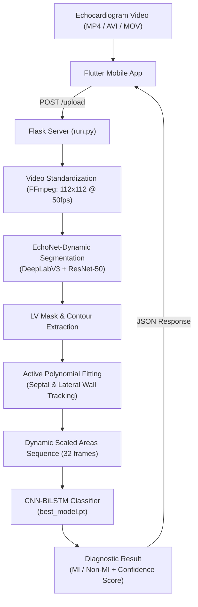

# Aura Early MI Detector

[](LICENSE)
[](https://www.python.org/)
[](https://pytorch.org/)
[](https://flutter.dev/)
[](https://flask.palletsprojects.com/)
[](https://github.com/echonet/dynamic)

An end-to-end deep learning and computer vision framework for **Early Myocardial Infarction (MI) detection** from apical four-chamber (A4C) echocardiogram videos. The system combines state-of-the-art semantic cardiac segmentation, biomechanical active contour/polynomial wall tracking, and a hybrid temporal deep learning classifier (1D-CNN + BiLSTM), exposed via a Flask backend and paired with a cross-platform Flutter mobile client.

---

## 📑 Table of Contents

- [Overview](#overview)
- [System Architecture & Pipeline](#system-architecture--pipeline)
- [Key Features](#key-features)
- [EchoNet-Dynamic Integration](#echonet-dynamic-integration)
- [Repository Structure](#repository-structure)
- [Prerequisites](#prerequisites)
- [Installation & Environment Setup](#installation--environment-setup)
- [How to Run](#how-to-run)
  - [1. Start the Flask Backend](#1-start-the-flask-backend)
  - [2. Run the Flutter Mobile App](#2-run-the-flutter-mobile-app)
  - [3. Test via REST API (cURL)](#3-test-via-rest-api-curl)
- [Model Training & Feature Extraction](#model-training--feature-extraction)
- [Acknowledgments & References](#acknowledgments--references)
- [License](#license)

---

## Overview

Myocardial Infarction (MI) requires rapid, reliable clinical triage. Traditional echocardiogram interpretation relies heavily on subjective visual assessment of Regional Wall Motion Abnormalities (RWMA) and ejection fraction calculations.

**Aura Early MI Detector** automates this diagnostic pathway:
1. Accepts raw echocardiography clips (AVI, MP4, MOV, MKV, etc.).
2. Normalizes the video stream using FFmpeg into standardized 112×112 frames at 50 FPS.
3. Automatically segments the Left Ventricle (LV) across each frame using a pretrained DeepLabV3-ResNet50 model integrated from **[EchoNet-Dynamic](https://github.com/echonet/dynamic)**.
4. Fits active polynomials to track wall boundaries (septal and lateral walls) and extracts frame-by-frame scaled ventricular area dynamics.
5. Classifies cardiac cycle dynamics using a tuned **1D-CNN + Bidirectional LSTM** network to deliver an immediate prediction (**MI** vs. **Non-MI**) with confidence scoring.

---

## System Architecture & Pipeline



### Detailed Pipeline Stages

1. **Video Ingestion & Conversion**:
   - The Flask server receives ultrasound recordings via `/upload`.
   - Non-AVI inputs are cropped to square and converted to standardized 112×112 AVI clips using FFmpeg.

2. **Left Ventricle Semantic Segmentation**:
   - Powered by the `dynamic-master` engine (EchoNet-Dynamic).
   - Uses a pretrained DeepLabV3 architecture with a ResNet-50 backbone to segment the left ventricular blood pool frame-by-frame.

3. **Active Polynomial Boundary & Area Tracking**:
   - Identifies the ventricular apex and base landmarks.
   - Splits boundary contours into left (septal) and right (lateral) walls.
   - Employs Savitzky-Golay filtering and polynomial fitting to smooth boundary tracking.
   - Computes sequential ventricular area variations over the cardiac cycle and outputs normalized 32-timestep sequence features (`scaled_areas.npy`).

4. **Temporal Classification (1D-CNN + BiLSTM)**:
   - A 2-stage 1D-Convolutional feature extractor captures local spatial and deformation cues.
   - A 2-layer Bidirectional LSTM processes forward and backward temporal dependencies across systolic and diastolic phases.
   - Fully connected layers with Batch Normalization and Dropout produce calibrated sigmoid probabilities for MI classification.

---

## Key Features

- **End-to-End Automated Pipeline**: From ultrasound video upload to diagnostic classification without manual tracing.
- **Deep Biomechanical Feature Extraction**: Tracks regional ventricular wall deformation rather than relying on raw pixel intensities alone.
- **Robust Model Training**:
  - Bayesian hyperparameter optimization using **Optuna**.
  - **Focal Loss** formulation to address class imbalance between MI and non-MI cases.
  - Stratified 5-Fold Cross-Validation.
- **Cross-Platform Mobile Interface**: Flutter mobile application for point-of-care upload, camera video capture, and immediate diagnostic visualization.
- **Lightweight Inference Server**: RESTful Flask API designed for seamless integration and low latency.

---

## EchoNet-Dynamic Integration

This project incorporates and builds upon **`dynamic-master`**, derived from the Stanford **[EchoNet-Dynamic](https://github.com/echonet/dynamic)** repository ([https://github.com/echonet](https://github.com/echonet)).

- **Role in Aura**: `dynamic-master` provides the underlying deep learning semantic segmentation models and video processing pipeline for Apical-4-Chamber (A4C) echocardiograms.
- **Upstream Citation**:
  > David Ouyang, Bryan He, Amirata Ghorbani, Neal Yuan, Joseph Ebinger, Curt P. Langlotz, Paul A. Heidenreich, Robert A. Harrington, David H. Liang, Euan A. Ashley, and James Y. Zou.  
  > *Video-based AI for beat-to-beat assessment of cardiac function.* **Nature**, 580(7802):252–256, 2020.  
  > DOI: [10.1038/s41586-020-2145-8](https://doi.org/10.1038/s41586-020-2145-8) | [EchoNet Website](https://echonet.github.io/dynamic/)

---

## Repository Structure

```text
Aura_Early_MI_Detecter_Project/
│
├── data/                                 # Datasets & annotations
│   ├── raw/                              # Raw MATLAB (.mat) ventricular masks
│   ├── processed/                        # Extracted .npy sequence arrays
│   ├── labels.csv                        # Derived patient labels & LVEF
│   └── labels_fixed.csv                  # Verified ground-truth labels
│
├── dynamic-master/                       # EchoNet-Dynamic submodule (Stanford EchoNet)
│   ├── echonet/                          # Core EchoNet dataset loaders & model utilities
│   │   ├── datasets/                     # Video & segmentation dataset readers
│   │   └── utils/                        # DeepLabV3 segmentation inference routines
│   ├── docs/                             # EchoNet documentation and media assets
│   ├── setup.py                          # EchoNet package installer
│   └── README.md                         # Upstream EchoNet documentation
│
├── experiments/                          # Prototyping & exploratory scripts
│   ├── test_active_contour.py            # Active contour (snakes) experiments on .mat masks
│   └── test_active_contour_image.py      # Polynomial curve fitting on echo frames
│
├── flask_server/                         # Backend Flask service
│   ├── run.py                            # Application entry point (runs on port 5000)
│   ├── app/
│   │   ├── __init__.py                   # App factory and upload configurations
│   │   ├── routes.py                     # API endpoints (/upload handler)
│   │   └── utils/
│   │       ├── active_polynomial.py      # LV contour splitting & polynomial fitting
│   │       ├── preprocessing.py          # Bridges Flask request to EchoNet segmentation
│   │       └── predict.py                # CNN-BiLSTM inference wrapper
│   └── ActivePolyOut/                    # Processed contour frames & scaled_areas.npy
│
├── mobile_app/                           # Flutter mobile client
│   ├── lib/
│   │   └── main.dart                     # UI for video picking, upload & result display
│   ├── pubspec.yaml                      # Flutter dependencies and assets
│   └── android/ ios/ web/ windows/       # Platform-specific configurations
│
├── models/                               # MI classification model definitions & weights
│   ├── model.py                          # CNN_BiLSTM_Classifier PyTorch architecture
│   ├── best_params.json                  # Tuned hyperparameters (lr, dropout, hidden_size)
│   └── best_model.pt                     # Checkpoint of highest-performing model weights
│
├── scripts/                              # Data transformation utilities
│   ├── extract_from_masks.py             # Computes LVEF & sequences from .mat masks
│   ├── load_data.py                      # Data validation & filename cleaning
│   └── make_labels.py                    # Label generation helper
│
├── training/                             # Model training and validation pipelines
│   ├── train.py                          # Stratified 5-Fold training with Optuna & Focal Loss
│   └── predict.py                        # Standalone evaluation script on .npy files
│
├── environment.yml                       # Conda environment specification
├── LICENSE                               # MIT License
└── README.md                             # Project documentation
```

---

## Prerequisites

Before setting up the project, ensure you have installed:

1. **Conda / Miniconda** (64-bit Windows, Linux, or macOS):
   - [Download Miniconda](https://docs.conda.io/en/latest/miniconda.html)
2. **FFmpeg**:
   - Required for video cropping and frame-rate conversions.
   - [Download FFmpeg](https://ffmpeg.org/download.html). Ensure `ffmpeg` is available on your system `PATH`.
3. **Flutter SDK** (Optional, only needed to run the mobile client):
   - [Install Flutter](https://docs.flutter.dev/get-started/install) (Flutter 3.x with Dart SDK >= 3.7.2).

---

## Installation & Environment Setup

### 1. Clone the Repository
```bash
git clone https://github.com/lasithhaputhanthri/Aura_Early_MI_Detecter_Project.git
cd Aura_Early_MI_Detecter_Project
```

### 2. Set Up the Conda Environment
Use the provided `environment.yml` to create and activate the `echo` environment:

```bash
conda env create -f environment.yml
conda activate echo
```

### 3. Verify FFmpeg Installation
```bash
ffmpeg -version
```
> [!IMPORTANT]
> FFmpeg must be executable from the terminal. If running on Windows, verify that your FFmpeg `bin` directory is added to system environment variables.

---

## How to Run

### 1. Start the Flask Backend

Run the Flask server from the project root:

```bash
python flask_server/run.py
```

The server will start at `http://0.0.0.0:5000` with the following active endpoints:
- `POST /upload`: Ingests an ultrasound video, triggers EchoNet segmentation, fits active polynomials, and returns MI prediction.

### 2. Run the Flutter Mobile App

1. Navigate to the mobile app directory:
   ```bash
   cd mobile_app
   flutter pub get
   ```

2. Configure your server IP:
   - In `mobile_app/lib/main.dart`, update the server URI to match your host machine's local IP address:
     ```dart
     final uri = Uri.parse("http://<YOUR_LOCAL_IP>:5000/upload");
     ```

3. Launch on a connected device, emulator, or Windows desktop:
   ```bash
   flutter run
   ```

### 3. Test via REST API (cURL)

You can test video diagnosis directly via the terminal:

```bash
curl -X POST http://localhost:5000/upload \
  -F "video=@path/to/echocardiogram.mp4"
```

**Example JSON Response:**
```json
{
  "MI": true,
  "confidence": 0.87
}
```

---

## Model Training & Feature Extraction

### Step 1: Feature Extraction from Raw Masks
If working with raw MATLAB `.mat` segmentations:
```bash
python scripts/extract_from_masks.py
```
This computes Left Ventricular Ejection Fraction (LVEF), classifies labels ($LVEF < 20\% \implies \text{MI}$), and outputs 32-frame sequence arrays into `data/processed/`.

### Step 2: Hyperparameter Tuning & Model Training
Train the CNN-BiLSTM classifier using Optuna optimization and 5-Fold Stratified Cross Validation:
```bash
python training/train.py
```
The script will search across learning rates, hidden dimensions, and dropout values, saving the top weights to `models/best_model.pt` and configurations to `models/best_params.json`.

### Step 3: Standalone Inference Test
Test the saved checkpoint on a sample `.npy` sequence:
```bash
python training/predict.py
```

---

## Model Architecture Details

```text
Input Sequence: [Batch, 32 Timesteps, 1 Feature (Scaled LV Area)]
 │
 ├── 1D-CNN Block 1: Conv1d(1, 32, k=3, p=1) -> BatchNorm1d -> ReLU
 ├── 1D-CNN Block 2: Conv1d(32, 64, k=3, p=1) -> BatchNorm1d -> ReLU
 │
 ├── 2-Layer Bidirectional LSTM: LSTM(input_size=64, hidden_size=H, bidirectional=True)
 │
 ├── Temporal Pooling: Last Timestep Vector [Batch, 2 * H]
 ├── Fully Connected 1: Linear(2 * H, 64) -> BatchNorm1d -> ReLU -> Dropout(p)
 └── Output Layer: Linear(64, 1) -> Sigmoid Output (Probability of MI)
```

---

## Acknowledgments & References

- **EchoNet-Dynamic**: Developed by the [EchoNet Research Team at Stanford University](https://github.com/echonet). We gratefully acknowledge their open-source models and dataset contributions that made the segmentation pipeline possible.
  - EchoNet-Dynamic GitHub: [https://github.com/echonet/dynamic](https://github.com/echonet/dynamic)
  - Stanford ML Group: [https://echonet.github.io/dynamic/](https://echonet.github.io/dynamic/)
- **PyTorch & Torchvision**: For deep learning framework and video transformation modules.
- **Flutter & Dart**: For providing a performant, modern cross-platform interface.

---

## License

This project is licensed under the **MIT License** — see the [LICENSE](LICENSE) file for complete details.  
Copyright (c) 2025 Lasith Haputhanthri.
